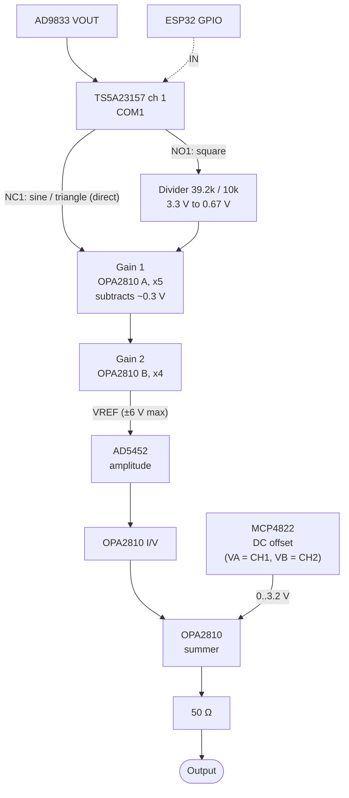

# Parts list

Every component in the function generator, what it does, and why it was picked.
Status: **in use** means the firmware drives it and it is on the board;
**in firmware** means the firmware drives it but the hardware isn't built yet;
**chosen** means picked, no firmware involved; **replaced** means no longer used.

Power is on the ordered board: a 12 V adapter, a TMR 6-1222 for ±12 V, an
LM7805 for +5 V and an AP2112K-3.3 for 3.3 V. See the Power section of
`docs/pinout_table.md`.

## Controller and user interface

| Part | Qty | Status | Role |
|---|---|---|---|
| ESP32-S3 N16R8 dev board (16 MB flash, 8 MB octal PSRAM) | 1 | in use | Runs everything: UI, Wi-Fi/MCP server, BLE, and SPI to the signal chips. Its 3.3 V pin also powers the 3.3 V chips below. |
| ILI9341 320x240 SPI TFT module with XPT2046 resistive touch | 1 | in use | Dashboard. LCD and touch share the second SPI bus (HSPI). |
| Mechanical rotary encoder with push button (EC11 style, 4 counts per detent) | 1 | in use | Knob for editing values. Decoded by the PCNT peripheral; button to GND with internal pull-up. |

## Signal chain

The x20 gain is split over two op-amps (x5 then x4) so each stage keeps a
wide bandwidth (see [Op-amp notes](#op-amp-notes)).

| Part | Qty | Status | Role |
|---|---|---|---|
| AD9833 DDS breakout module (25 MHz oscillator on board) | 1 | in use | Makes the sine, triangle and square. Power it from 3.3 V so the square is 3.3 Vpp and the SPI logic matches the ESP32. Sine/triangle come out at about 38 mV to 650 mV. |
| TS5A23157 dual SPDT analog switch module (VSSOP-10 on a breakout) | 1 | in firmware | Channel 1 sends CH1's AD9833 output down the direct sine/triangle path (NC1) or the divided square path (NO1), driven by `PIN_WAVE_SWITCH` (`IN1`). The switch moves to the divided path before a square starts and back only after it stops. Channel 2 does the same for CH2; `PIN_WAVE_SWITCH_2` (`IN2`) is HIGH (divided path) from the top of `setup()` until CH2's parking `begin()` has reset its AD9833 to sine. |
| AD5452 12-bit multiplying DAC (AD5452YRMZ, MSOP-8) | 1 per channel | in firmware | Scales the amplified wave from 0 to 100 %. Driver: `src/libs/AD5452/` (see `docs/AD5452.md`). About $9.50 each at DigiKey (≈1,600 in stock, Nov 2026). Needs one 100 nF cap from VDD to GND, right at the chip. |
| MCP4822 dual 12-bit voltage DAC (MCP4822-E/SN, SOIC-8) | 1 (shared) | in firmware | DC offset for both channels: `VOUTA` = CH1, `VOUTB` = CH2. Internal 2.048 V reference, run at 2x gain (1 mV per code) on 3.3 V. The summer (R12 = R29 = R13 = 4.02 kΩ) turns it into the offset: 3.0 × Vdac − 5 V, so 0..3.2 V (`OFFSET_DAC_CODE_MAX`) covers −5..+4.6 V. +5 V would need about 3.33 V, past where the 2x output clips near VDD. The −5 V comes from the +5 V rail, so rail drift moves the offset 1:1. Driver: `src/libs/MCP4822/` (see `docs/MCP4822.md`). Replaces the two offset AD5452s and their shared I/V op-amp to cut cost. 100 nF from VDD to GND at the chip. |
| OPA2810 dual FET op-amp (OPA2810IDGKT, VSSOP-8) | 2 per channel (4 for two channels) | chosen | Per channel, two chips for the four fast stages: gain 1, gain 2, the amplitude AD5452's I/V, and the summer that drives the output. The offset needs no op-amp of its own (the MCP4822 is voltage-output). See [Op-amp notes](#op-amp-notes). |
| Resistors and capacitors | — | on the board | Square divider (39.2 kΩ / 10 kΩ), gain-setting resistors, summer resistors, 1–2 pF compensation across the AD5452's RFB, and decoupling (100 nF at every chip, plus 10 µF per rail near the OPA2810s). |
| 50 Ω output resistor, 0.5 W (or two 100 Ω 1/4 W in parallel) | 1 | chosen | Protects the summer op-amp and keeps it stable into the cable. See "Output current and the 50 Ω resistor" below. |
| Output connector (BNC) | 1 | TBD | Scope cable. |
| MSOP-8 and SOIC-8 to DIP adapter boards | 2 + 2 | — | For breadboard or perfboard. The switch comes on its own module, so it needs no adapter. |

### Replaced

| Part | Replaced by | Why |
|---|---|---|
| AD5452 + OPA2810 I/V (DC offset, one per channel) | MCP4822 | The offset only needs a slow, steady DC level, so a cheap dual voltage DAC does it. One MCP4822 covers both channels and needs no I/V op-amp or offset reference. It loses the ratiometric match with the summer's +5 V shift, so the offset has to be calibrated. |
| MCP4131 digital pot (in the op-amp gain loop) | AD5452 | The MCP4131's signal has to stay within 0..VDD, it has only 7 bits (129 steps), and its wiper resistance and capacitance limit bandwidth to about 2 MHz. The AD5452 takes ±10 V straight on VREF and has 4096 steps. |
| 2N7000 MOSFET (square divider switch) | TS5A3159A | A real SPDT analog switch selects between two paths cleanly. A MOSFET in the divider only switches one leg to ground. |
| TS5A3159A SPDT analog switch (SOT-23-6) | TS5A23157 | Sold as a ready-made breakout module, so it's easier to buy and wire. It's a dual switch, so one chip covers both channels. Its higher on-resistance doesn't matter here (see below). |

The MCP4131 library and its doc were removed from the project (still in git history).

## Why these parts

### MDAC: AD5452

| Spec (from the datasheet) | Value | Why it matters here |
|---|---|---|
| Resolution | 12 bits, 4096 steps | 12 Vpp / 4096 is about 3 mV per step. |
| Reference input range | ±10 V (abs. max ±12 V) | The ±6 V (12 Vpp) wave goes straight in. No level shifting needed. |
| VREF input resistance | 9 kΩ typ (7–11 kΩ) | Easy load for the gain stage. Constant with code, so the gain stage sees the same load at every amplitude. |
| RFB feedback resistor | 9 kΩ, matched to the ladder | Used as the I/V op-amp's feedback resistor, so full-scale gain is exactly −1 without trimming. |
| Reference multiplying bandwidth | 10 MHz min (VREF ±3.5 V, all 1s) | Far faster than the op-amps, so the AD5452 is never the bottleneck. |
| Supply | 2.5–5.5 V | Runs from the ESP32 board's 3.3 V. VIH is 1.7 V at 2.5–3.6 V, so 3.3 V logic is fine. |
| Interface | SPI, up to 50 MHz, data clocked on the falling SCLK edge by default | The driver uses SPI_MODE1 (the datasheet's own interfacing example). Each transfer sets its own mode, so it shares the generator bus with the AD9833 (SPI_MODE2). One CS (SYNC) pin per AD5452. |
| Power-on state | Zero scale | Output is 0 V at boot, before the firmware sets anything. |
| Packages | MSOP-8 (AD5452YRMZ) or TSOT-8 (AD5452YUJ) | MSOP-8 is easier to hand-solder onto an adapter. |

Serial word, 16 bits MSB first: `C1 C0 D11..D0 X X`, so the firmware sends
`code << 2` with C1 C0 = 00 (load and update). Don't send C1 C0 = 11: it moves
clocking to the rising edge and stops the DAC until the next frame.

Output: `Vout = −VREF × code / 4096`. The minus sign is cancelled by the
inverting summer, so the final output is the right way up.

### Offset DAC: MCP4822

| Spec (from the datasheet) | Value | Why it matters here |
|---|---|---|
| Resolution | 12 bits, two channels | One chip covers both channels' offsets. At 2x gain a code is 1 mV, 3 mV of offset. |
| Reference | Internal 2.048 V, output gain 1x or 2x | 2x gives 0..4.095 V; the offset stage needs up to 3.2 V (+4.6 V), which 1x can't reach. |
| Output swing | Up to about VDD | On 3.3 V the top codes clip at 2x, so the firmware stops at `OFFSET_DAC_CODE_MAX` (3200). |
| Supply | 2.7–5.5 V | Runs from the ESP32 board's 3.3 V, so its logic levels match the ESP32. |
| Interface | SPI mode 0 or 3, up to 20 MHz | The driver uses SPI_MODE0. Shares the generator bus; CS on GPIO14, `LDAC` tied to GND. |
| Power-on state | Both channels shut down (≈0 V out) | About −5 V offset until `FunctionGenerator::begin()` writes the 0 V code. Both channels' `begin()` run right after the safe pin states, so `VOUTB` is set too. |
| Package | SOIC-8 (MCP4822-E/SN) | |

Serial word, 16 bits MSB first: `A/B - GA SHDN D11..D0` (A/B: 1 = channel B,
GA: 0 = 2x, SHDN: 1 = on).

Alternatives considered:

- **AD5453 (14-bit)**: same pinout and family. The extra 2 bits don't help when the op-amps and noise are the limit.
- **AD5450 / AD5451 (8 / 10-bit)**: same package, too coarse for 12 Vpp.
- **AD5415 (dual 12-bit, TSSOP-24)**: one chip for both channels, but the package is harder to hand-solder and the driver is different.
- **MCP4131 / MCP4151**: see Replaced above.

### Analog switch: TS5A23157

- Dual SPDT, one control pin per channel: COMx connects to NCx when INx is low, to NOx when INx is high. Each channel is wired as a 1:2 demux: COM takes the AD9833 output, NC goes straight to the gain stage input (sine/triangle), NO goes through the 39.2 kΩ / 10 kΩ divider to the same input (square). Channel 1 is CH1, channel 2 is CH2.
- 1.65–5.5 V supply, powered from 3.3 V. COM sees the AD9833's 0–3.3 V, inside the supply. Control inputs are 5 V tolerant.
- On-resistance about 10 Ω, 220 MHz bandwidth, break-before-make. The direct path drives an op-amp's high-impedance + input (and the divider's 10 kΩ to GND), so the 10 Ω adds no error worth measuring.
- VSSOP-10, bought as a breakout module. The module has its own pull resistors on the IN pins; there are none on the board.
- The direct path only takes the ~0.65 V sine/triangle: a 3.3 V square on it saturates the x20 gain. The firmware drives both IN pins HIGH (divided path, safe for any waveform) from the top of `setup()`, keeps each channel there until its AD9833 is reset to sine, and orders every waveform change so a square never reaches the direct path.

Alternative considered: **ADG719** (Analog Devices, SOT-23-6, 4 Ω max, >200 MHz).
It works just as well but costs more. Either is far faster than the op-amps.

### Op-amp notes

Every op-amp is an **OPA2810** (TI, dual, VSSOP-8, about $4–5 each). Two per
channel give the four fast op-amps. A fifth chip used to hold both channels'
offset I/V stages; the MCP4822 is voltage-output, so it's gone. The TL071CP
was the earlier pick for the offset I/V; it's kept in the table below for
comparison.

| Spec (TI product page) | OPA2810 | TL071CP |
|---|---|---|
| Supply | 4.75–27 V total (**±13.5 V max**) | up to ±18 V |
| Gain-bandwidth | 70 MHz | 3–4 MHz |
| Slew rate | 192 V/µs | 13 V/µs |
| Linear output current | 75 mA | ~10–20 mA |
| Input bias current | 2 pA typ (FET) | pA (JFET) |
| Output | rail-to-rail | about 1.5–3 V from each rail |
| Unity-gain stable | yes | yes |

What that means at 12 Vpp:

| Limit | TL071 everywhere | OPA2810 in the signal path |
|---|---|---|
| Full 12 Vpp sine (slew limit) | up to ~345 kHz | up to ~5 MHz |
| ×20 gain −3 dB point | ~150–200 kHz (one stage) | ~10 MHz (×5 then ×4, two stages) |
| Amplitude flat within ~1 % | to ~20–30 kHz | to ~1–2 MHz |
| 12 V square edge | ~1 µs | ~60 ns |
| Max amplitude at 12.5 MHz | well under 1 Vpp | ~4.9 Vpp |

Above about 5 MHz the AD9833's own sine gets rough (few DAC samples per cycle),
so the OPA2810 covers the range where the AD9833 is actually useful.

Why split the gain into ×5 and ×4: a voltage-feedback op-amp's bandwidth is
about GBW / gain. One ×20 stage gets 70 / 20 = 3.5 MHz; two stages get about
12 MHz and 17 MHz, which cascade to roughly 10 MHz.

The FET input matters for the AD5452's I/V stage: the datasheet asks for low
bias current and low offset voltage, and the OPA2810 has both (2 pA, ±1.5 mV max).

Alternatives considered:

- **LM318** (DIP-8, 15 MHz, 70 V/µs): no adapter needed, but full 12 Vpp only to ~1.9 MHz, and its bipolar inputs have higher bias current for the MDAC stage.
- **AD8066** (dual FET, 145 MHz, 180 V/µs): similar speed and price, but its 24 V total supply max leaves no margin at ±12 V.
- **LT1364** (dual, 70 MHz, 1000 V/µs): full 12 Vpp to ~25 MHz, far past what the AD9833 can use. About twice the price.
- **THS4631** (single, ±15 V, ~1000 V/µs): also fast, but single and pricier, so three would be needed.

## Output current and the 50 Ω resistor

The summer is the only op-amp that drives the outside world. With a scope
(1 MΩ) on the end, its load is:

| Load | Peak current at 12 Vpp |
|---|---|
| Scope input, 1 MΩ | ~6 µA (nothing) |
| Summer feedback resistor (say 1 kΩ) | ~6 mA |
| 1 m of coax (~100 pF), charged at 5 MHz: C × 2πf × 6 V | ~19 mA |
| **Total** | **~25 mA**, well under the OPA2810's 75 mA |

So no extra buffer or current booster is needed for a high-Z load.

The 50 Ω series resistor still goes in:

- It keeps the op-amp stable. A fast op-amp driving cable capacitance directly can ring or oscillate; the resistor isolates it.
- It limits current when the output is shorted (BNC touching ground, for example). Use 0.5 W or two 100 Ω 1/4 W in parallel. A shorted 12 Vpp sine puts about 0.36 W in the resistor.
- It matches 50 Ω coax at the source, so long cables don't ring.

If someone plugs a 50 Ω load in anyway: the output halves (the 50 Ω resistor and
the load form a divider), and the peak current is (6 V + offset) / 100 Ω, about
60–110 mA. That is above the 75 mA linear limit, so the top of the wave
distorts and the chip gets warm. It is not a supported load. The amplitude on
the screen means "into high-Z".

## Firmware

Done (host-tested, compiled, not tried on hardware). All pins and constants are
in `src/config.h`; only `core/func_gen.*` drives the chips.

- **Safe pin states:** `holdSafePinStates()` (`core/safe_pins.*`) is the first thing `setup()` does: both relays LOW (open), every generator `FSYNC`/`SYNC`/`CS` HIGH (deselected, so no driver's `begin()` blips one LOW), both path switches HIGH (divided). Each pin is claimed as an input before its level is set, because ESP32 core 3.x drops `digitalWrite()` on a pin `pinMode()` hasn't claimed.
- **Boot order:** right after the safe pin states, both channels' `FunctionGenerator::begin()` run, before the boot screen hold. CH2 isn't in the firmware yet; its `begin()` only parks the chips (AD9833 reset to sine and asleep, amplitude 0, `VOUTB` at the 0 V code, relay open). Before `setup()` (ROM bootloader, PSRAM init) the firmware can't drive anything, so only the module and board resistors hold the pins then.
- **TS5A23157:** `PIN_WAVE_SWITCH` (`IN1`), HIGH for square, set in `setWaveform`: HIGH before the AD9833 starts a square, LOW only after it stops. `PIN_WAVE_SWITCH_2` (`IN2`) belongs to CH2, parked on sine (LOW) after its `begin()`.
- **AD5452:** `PIN_AMP_DAC_CS` on the generator bus, driver in `src/libs/AD5452/`.
- **MCP4822:** `PIN_OFFSET_DAC_CS` (GPIO14) on the generator bus, `LDAC` tied to GND. CH1 uses `VOUTA` (`OFFSET_DAC_CHANNEL`), CH2 will use `VOUTB` (`OFFSET_DAC_CHANNEL_2`). Driver in `src/libs/MCP4822/`.
- **Amplitude:** code = amplitude / `AMP_FULL_CODE_VPP_*` × 4095 (per waveform).
- **DC offset:** straight line through two measured points (`OFFSET_V_AT_CAL_LOW` at code `OFFSET_CAL_CODE_LOW`, `OFFSET_V_AT_CAL_HIGH` at `OFFSET_CAL_CODE_HIGH`), never above `OFFSET_DAC_CODE_MAX` where the 2x output clips at VDD.
- **Peak limit:** amplitude / 2 + |offset| ≤ `OUTPUT_PEAK_MAX_V` (10 V for now). The value being changed stops at the edge.
- **Output relay:** Omron G5V-1 DC5. `PIN_OUTPUT_RELAY` (GPIO41), HIGH = connected. Opens first when the output turns off, closes last when it turns on, open from power-on until a user turns the output on. `PIN_OUTPUT_RELAY_2` (GPIO13) belongs to CH2 and stays LOW (open).
- **Output off:** relay open, amplitude DAC to 0 and offset DAC to its 0 V code.
- **Calibration:** measure the full-code amplitude per waveform and the offset at the two calibration codes, then put the numbers in `config.h`.
- **Not done, optional:** above ~5 MHz the OPA2810's slew rate caps the amplitude at about 2 × 192 V/µs / (2π f). The firmware could clamp amplitude by frequency so the screen never shows a value the hardware can't make.

## Open items

- **Power:** on the board (12 V adapter, TMR 6-1222 for ±12 V, LM7805, AP2112K-3.3). Check the ±12 V rails on the bench: they must stay at or below **±13.5 V** (the OPA2810's 27 V max).
- **Max frequency:** full 12 Vpp up to ~5 MHz with the OPA2810. Measure it, then decide whether `FREQ_MAX_HZ` stays at 12.5 MHz with a reduced amplitude up there.
- **Passive values:** on the ordered board (square divider 39.2 kΩ / 10 kΩ = 0.67 V from 3.3 V, no low-pass on the sine path). What's left is measuring the stage and filling in the calibration values in `config.h`.

## Sources

- AD5450/AD5451/AD5452 datasheet, Rev. 0 (Analog Devices): spec table, serial interface section (Table 10), amplifier selection, ordering guide.
- MCP4802/4812/4822 datasheet, DS20002249 (Microchip): write command register, SPI modes, shutdown, output swing.
- TS5A23157 datasheet SCDS165 and product page (TI); TS5A3159A and ADG719 parametric listings (TI, Analog Devices).
- TL071 and LM318 datasheets (TI).
- OPA2810 product page (TI): supply, GBW, slew rate, output current, packages.
- AD8066 and LT1364 product pages (Analog Devices).
