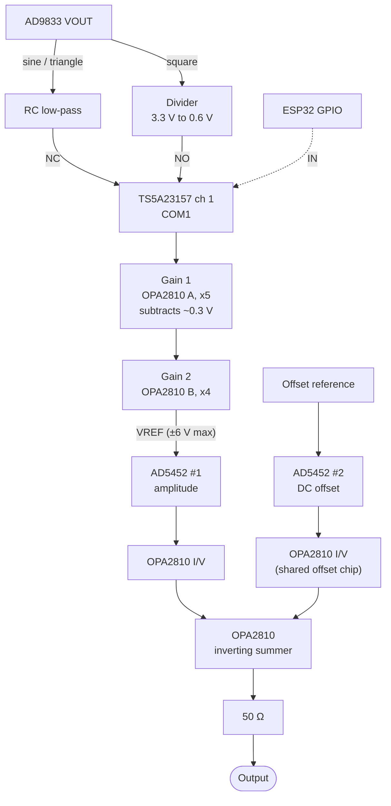

# Parts list

Every component in the function generator, what it does, and why it was picked.
Status: **in use** means the firmware drives it and it is on the board;
**in firmware** means the firmware drives it but the hardware isn't built yet;
**chosen** means picked, no firmware involved; **replaced** means no longer used.

Power (wall adapter, rails, regulators) is not decided yet and is left out on
purpose. See [Open items](#open-items).

## Controller and user interface

| Part | Qty | Status | Role |
|---|---|---|---|
| ESP32-S3 N16R8 dev board (16 MB flash, 8 MB octal PSRAM) | 1 | in use | Runs everything: UI, Wi-Fi/MCP server, BLE, and SPI to the signal chips. Its 3.3 V pin also powers the 3.3 V chips below. |
| ILI9341 320x240 SPI TFT module with XPT2046 resistive touch | 1 | in use | Dashboard. LCD and touch share the second SPI bus (HSPI). |
| Mechanical rotary encoder with push button (EC11 style, 4 counts per detent) | 1 | in use | Knob for editing values. Decoded by the PCNT peripheral; button to GND with internal pull-up. |

## Signal chain

The x20 gain is split over two op-amps (x5 then x4) so each stage keeps a
wide bandwidth (see [Op-amp notes](#op-amp-notes)).

| Part | Qty | Status | Role |
|---|---|---|---|
| AD9833 DDS breakout module (25 MHz oscillator on board) | 1 | in use | Makes the sine, triangle and square. Power it from 3.3 V so the square is 3.3 Vpp and the SPI logic matches the ESP32. Sine/triangle come out at about 38 mV to 650 mV. |
| TS5A23157 dual SPDT analog switch module (VSSOP-10 on a breakout) | 1 | in firmware | Channel 1 picks CH1's filtered sine/triangle path (NC1) or divided square path (NO1), driven by `PIN_WAVE_SWITCH` (`IN1`). Channel 2 does the same for CH2; `PIN_WAVE_SWITCH_2` (`IN2`) is reserved but not driven yet. |
| AD5452 12-bit multiplying DAC (AD5452YRMZ, MSOP-8) | 2 | in firmware | #1 scales the amplified wave from 0 to 100 %. #2 sets the DC offset. Driver: `src/libs/AD5452/` (see `docs/AD5452.md`). About $9.50 each at DigiKey (≈1,600 in stock, Nov 2026). Needs one 100 nF cap from VDD to GND, right at the chip. |
| OPA2810 dual FET op-amp (OPA2810IDGKT, VSSOP-8) | 2 per channel + 1 shared (5 for two channels) | chosen | Per channel, two chips for the four fast stages: gain 1, gain 2, the amplitude AD5452's I/V, and the summer that drives the output. The fifth chip holds both channels' offset AD5452 I/V stages (A = CH1, B = CH2). See [Op-amp notes](#op-amp-notes). |
| Resistors and capacitors | — | values TBD | Square divider, RC low-pass on the sine path, gain-setting resistors, summer resistors, 1–2 pF compensation across each AD5452's RFB, and decoupling (100 nF at every chip, plus 10 µF per rail near the OPA2810s). |
| 50 Ω output resistor, 0.5 W (or two 100 Ω 1/4 W in parallel) | 1 | chosen | Protects the summer op-amp and keeps it stable into the cable. See "Output current and the 50 Ω resistor" below. |
| Output connector (BNC) | 1 | TBD | Scope cable. |
| MSOP-8 and SOIC-8 to DIP adapter boards | 2 + 2 | — | For breadboard or perfboard. The switch comes on its own module, so it needs no adapter. |

### Replaced

| Part | Replaced by | Why |
|---|---|---|
| MCP4131 digital pot (in the op-amp gain loop) | AD5452 | The MCP4131's signal has to stay within 0..VDD, it has only 7 bits (129 steps), and its wiper resistance and capacitance limit bandwidth to about 2 MHz. The AD5452 takes ±10 V straight on VREF and has 4096 steps. |
| 2N7000 MOSFET (square divider switch) | TS5A3159A | A real SPDT analog switch selects between two paths cleanly. A MOSFET in the divider only switches one leg to ground. |
| TS5A3159A SPDT analog switch (SOT-23-6) | TS5A23157 | Sold as a ready-made breakout module, so it's easier to buy and wire. It's a dual switch, so one chip covers both channels. Its higher on-resistance doesn't matter here (see below). |

The MCP4131 library and its doc were removed from the project (still in git history).

## Why these parts

### MDAC: AD5452

| Spec (from the datasheet) | Value | Why it matters here |
|---|---|---|
| Resolution | 12 bits, 4096 steps | 12 Vpp / 4096 is about 3 mV per step. |
| Reference input range | ±10 V (abs. max ±12 V) | The ±6 V (12 Vpp) wave goes straight in. No level shifting needed. |
| VREF input resistance | 9 kΩ typ (7–11 kΩ) | Easy load for the gain stage. Constant with code, so the gain stage sees the same load at every amplitude. |
| RFB feedback resistor | 9 kΩ, matched to the ladder | Used as the I/V op-amp's feedback resistor, so full-scale gain is exactly −1 without trimming. |
| Reference multiplying bandwidth | 10 MHz min (VREF ±3.5 V, all 1s) | Far faster than the op-amps, so the AD5452 is never the bottleneck. |
| Supply | 2.5–5.5 V | Runs from the ESP32 board's 3.3 V. VIH is 1.7 V at 2.5–3.6 V, so 3.3 V logic is fine. |
| Interface | SPI, up to 50 MHz, data clocked on the falling SCLK edge by default | The driver uses SPI_MODE1 (the datasheet's own interfacing example). Each transfer sets its own mode, so it shares the generator bus with the AD9833 (SPI_MODE2). One CS (SYNC) pin per AD5452. |
| Power-on state | Zero scale | Output is 0 V at boot, before the firmware sets anything. |
| Packages | MSOP-8 (AD5452YRMZ) or TSOT-8 (AD5452YUJ) | MSOP-8 is easier to hand-solder onto an adapter. |

Serial word, 16 bits MSB first: `C1 C0 D11..D0 X X`, so the firmware sends
`code << 2` with C1 C0 = 00 (load and update). Don't send C1 C0 = 11: it moves
clocking to the rising edge and stops the DAC until the next frame.

Output: `Vout = −VREF × code / 4096`. The minus sign is cancelled by the
inverting summer, so the final output is the right way up.

Alternatives considered:

- **AD5453 (14-bit)**: same pinout and family. The extra 2 bits don't help when the op-amps and noise are the limit.
- **AD5450 / AD5451 (8 / 10-bit)**: same package, too coarse for 12 Vpp.
- **AD5415 (dual 12-bit, TSSOP-24)**: one chip for both channels, but the package is harder to hand-solder and the driver is different.
- **MCP4131 / MCP4151**: see Replaced above.

### Analog switch: TS5A23157

- Dual SPDT, one control pin per channel: COMx connects to NCx when INx is low, to NOx when INx is high. Each channel is wired as a 2:1 mux: COM goes to the gain stage, NC to the sine path, NO to the square divider. Channel 1 is CH1, channel 2 is CH2.
- 1.65–5.5 V supply, powered from 3.3 V. Both inputs are 0–0.65 V after the divider, well inside the supply. Control inputs are 5 V tolerant.
- On-resistance about 10 Ω, 220 MHz bandwidth, break-before-make. COM drives an op-amp's high-impedance + input, so the 10 Ω adds no error worth measuring.
- VSSOP-10, bought as a breakout module.
- Put a pull-down on each IN so both channels sit on the sine path while the ESP32 boots.

Alternative considered: **ADG719** (Analog Devices, SOT-23-6, 4 Ω max, >200 MHz).
It works just as well but costs more. Either is far faster than the op-amps.

### Op-amp notes

Every op-amp is an **OPA2810** (TI, dual, VSSOP-8, about $4–5 each). Two per
channel give the four fast op-amps; a fifth chip holds both channels' offset
I/V stages. The offset path is DC, so it doesn't need the speed, but one part
type keeps the BOM simple and its low offset voltage suits the MDAC I/V stage.
The TL071CP was the earlier pick for the offset I/V; it's kept in the table
below for comparison.

| Spec (TI product page) | OPA2810 | TL071CP |
|---|---|---|
| Supply | 4.75–27 V total (**±13.5 V max**) | up to ±18 V |
| Gain-bandwidth | 70 MHz | 3–4 MHz |
| Slew rate | 192 V/µs | 13 V/µs |
| Linear output current | 75 mA | ~10–20 mA |
| Input bias current | 2 pA typ (FET) | pA (JFET) |
| Output | rail-to-rail | about 1.5–3 V from each rail |
| Unity-gain stable | yes | yes |

What that means at 12 Vpp:

| Limit | TL071 everywhere | OPA2810 in the signal path |
|---|---|---|
| Full 12 Vpp sine (slew limit) | up to ~345 kHz | up to ~5 MHz |
| ×20 gain −3 dB point | ~150–200 kHz (one stage) | ~10 MHz (×5 then ×4, two stages) |
| Amplitude flat within ~1 % | to ~20–30 kHz | to ~1–2 MHz |
| 12 V square edge | ~1 µs | ~60 ns |
| Max amplitude at 12.5 MHz | well under 1 Vpp | ~4.9 Vpp |

Above about 5 MHz the AD9833's own sine gets rough (few DAC samples per cycle),
so the OPA2810 covers the range where the AD9833 is actually useful.

Why split the gain into ×5 and ×4: a voltage-feedback op-amp's bandwidth is
about GBW / gain. One ×20 stage gets 70 / 20 = 3.5 MHz; two stages get about
12 MHz and 17 MHz, which cascade to roughly 10 MHz.

The FET input matters for the AD5452's I/V stage: the datasheet asks for low
bias current and low offset voltage, and the OPA2810 has both (2 pA, ±1.5 mV max).
That applies to both AD5452s, so the offset I/V uses it too (the TL071's offset
voltage is up to about 10 mV).

Alternatives considered:

- **LM318** (DIP-8, 15 MHz, 70 V/µs): no adapter needed, but full 12 Vpp only to ~1.9 MHz, and its bipolar inputs have higher bias current for the MDAC stage.
- **AD8066** (dual FET, 145 MHz, 180 V/µs): similar speed and price, but its 24 V total supply max leaves no margin at ±12 V.
- **LT1364** (dual, 70 MHz, 1000 V/µs): full 12 Vpp to ~25 MHz, far past what the AD9833 can use. About twice the price.
- **THS4631** (single, ±15 V, ~1000 V/µs): also fast, but single and pricier, so three would be needed.

## Output current and the 50 Ω resistor

The summer is the only op-amp that drives the outside world. With a scope
(1 MΩ) on the end, its load is:

| Load | Peak current at 12 Vpp |
|---|---|
| Scope input, 1 MΩ | ~6 µA (nothing) |
| Summer feedback resistor (say 1 kΩ) | ~6 mA |
| 1 m of coax (~100 pF), charged at 5 MHz: C × 2πf × 6 V | ~19 mA |
| **Total** | **~25 mA**, well under the OPA2810's 75 mA |

So no extra buffer or current booster is needed for a high-Z load.

The 50 Ω series resistor still goes in:

- It keeps the op-amp stable. A fast op-amp driving cable capacitance directly can ring or oscillate; the resistor isolates it.
- It limits current when the output is shorted (BNC touching ground, for example). Use 0.5 W or two 100 Ω 1/4 W in parallel. A shorted 12 Vpp sine puts about 0.36 W in the resistor.
- It matches 50 Ω coax at the source, so long cables don't ring.

If someone plugs a 50 Ω load in anyway: the output halves (the 50 Ω resistor and
the load form a divider), and the peak current is (6 V + offset) / 100 Ω, about
60–110 mA. That is above the 75 mA linear limit, so the top of the wave
distorts and the chip gets warm. It is not a supported load. The amplitude on
the screen means "into high-Z".

## Firmware

Done (host-tested, compiled, not tried on hardware). All pins and constants are
in `src/config.h`; only `core/func_gen.*` drives the chips.

- **TS5A23157:** `PIN_WAVE_SWITCH` (`IN1`), HIGH for square, set in `setWaveform`. `PIN_WAVE_SWITCH_2` (`IN2`) is reserved for CH2 and not driven yet.
- **AD5452 × 2:** `PIN_AMP_DAC_CS` and `PIN_OFFSET_DAC_CS` on the generator bus, driver in `src/libs/AD5452/`.
- **Amplitude:** code = amplitude / `AMP_FULL_CODE_VPP_*` × 4095 (per waveform).
- **DC offset:** straight line between `OFFSET_V_AT_CODE_0` and `OFFSET_V_AT_FULL_CODE`.
- **Peak limit:** amplitude / 2 + |offset| ≤ `OUTPUT_PEAK_MAX_V` (10 V for now). The value being changed stops at the edge.
- **Output off:** amplitude DAC to 0 and offset DAC to its 0 V code.
- **Calibration:** measure the full-code amplitude per waveform and the offset at both ends, then put the numbers in `config.h`.
- **Not done, optional:** above ~5 MHz the OPA2810's slew rate caps the amplitude at about 2 × 192 V/µs / (2π f). The firmware could clamp amplitude by frequency so the screen never shows a value the hardware can't make.

## Open items

- **Power:** a wall adapter is planned. The analog side needs about ±12 V; the 3.3 V chips run from the ESP32 board. Not chosen yet. The rails must stay at or below **±13.5 V** (the OPA2810's 27 V max), so ±15 V is out.
- **Offset reference:** AD5452 #2 needs a steady DC voltage on its VREF, plus a fixed resistor into the summer so that mid-scale code gives 0 V offset. The voltage is not chosen yet.
- **Max frequency:** full 12 Vpp up to ~5 MHz with the OPA2810. Measure it, then decide whether `FREQ_MAX_HZ` stays at 12.5 MHz with a reduced amplitude up there.
- **Passive values:** square divider (for example 8.2 kΩ over 1.8 kΩ gives 0.59 V from 3.3 V), the RC low-pass, and the gain-stage resistors.

## Sources

- AD5450/AD5451/AD5452 datasheet, Rev. 0 (Analog Devices): spec table, serial interface section (Table 10), amplifier selection, ordering guide.
- TS5A23157 datasheet SCDS165 and product page (TI); TS5A3159A and ADG719 parametric listings (TI, Analog Devices).
- TL071 and LM318 datasheets (TI).
- OPA2810 product page (TI): supply, GBW, slew rate, output current, packages.
- AD8066 and LT1364 product pages (Analog Devices).
